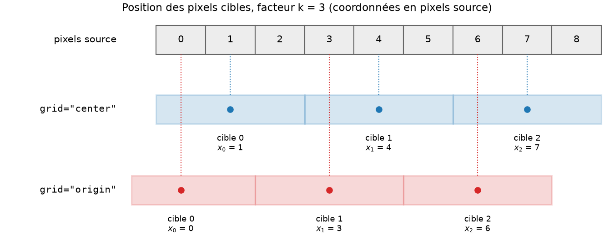
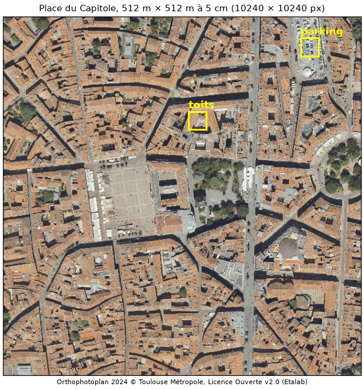
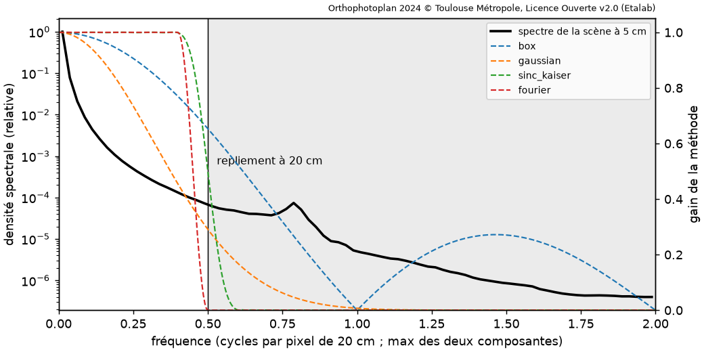
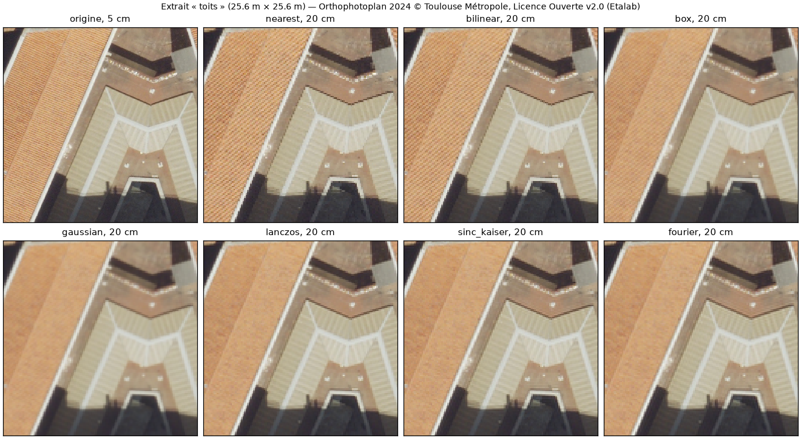
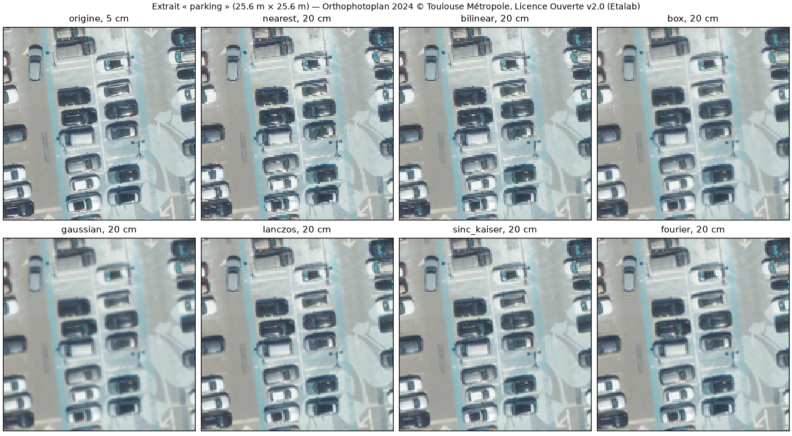

# Référence technique — eoqual-resampling

Principe, implémentation et limites de chaque méthode de réduction de
résolution. Les résultats chiffrés sont dans [BENCHMARK.md](BENCHMARK.md),
les références complètes dans [BIBLIOGRAPHY.md](BIBLIOGRAPHY.md).

## Sommaire

1. [Le problème](#1-le-problème)
2. [Géométrie de la grille cible](#2-géométrie-de-la-grille-cible)
3. [Méthodes séparables](#3-méthodes-séparables)
4. [Les noyaux](#4-les-noyaux)
5. [Méthodes spectrales](#5-méthodes-spectrales)
6. [Simuler un capteur : `mtf_target`](#6-simuler-un-capteur--mtf_target)
7. [Diagnostic](#7-diagnostic)
8. [Cas réel : orthophotographie de 5 cm à 20 cm](#8-cas-réel--orthophotographie-de-5-cm-à-20-cm)
9. [Évolutions envisagées](#9-évolutions-envisagées)
10. [Tests](#10-tests)
11. [Annexe A — Historique des choix et corrections](#annexe-a--historique-des-choix-et-corrections)

---

## 1. Le problème

Réduire une image d'un facteur `k` (taille d'un pixel cible en pixels
source), c'est l'échantillonner sur une grille `k` fois plus lâche. Le
Nyquist passe de 0,5 cycle par pixel source à 0,5 cycle par pixel
**cible**, soit `0,5 / k` cycle par pixel source. Tout ce qui dépasse ce
nouveau Nyquist se **replie** : une fréquence `f > 0,5` (en cycles par
pixel cible) réapparaît en `1 - f`, fausse basse fréquence
indiscernable d'un vrai détail (moiré, crénelage).

Une réduction « idéale » doit donc :

1. **filtrer** pour supprimer ce qui dépasserait le nouveau Nyquist, sans
   atténuer ce qui est en deçà ;
2. **échantillonner** aux positions des pixels cibles, sans décalage ;
3. **conserver les niveaux** (une image uniforme reste uniforme, la
   moyenne est conservée).

Le filtre idéal (sinus cardinal infini, réponse en créneau) est
irréalisable et oscillerait fortement près des bords nets (phénomène de
Gibbs). Toute méthode réelle arbitre entre trois défauts : **repliement**
(réponse non nulle au-delà du Nyquist), **flou** (réponse inférieure à 1
en deçà) et **oscillations** (lobes négatifs du noyau).

Notations : `f` est toujours en **cycles par pixel cible** (Nyquist cible
0,5 ; Nyquist source `k / 2`), sauf mention contraire. Les paramètres
des méthodes sont en unités cibles, si bien qu'un réglage garde le même
sens quel que soit `k`.

## 2. Géométrie de la grille cible

Le centre du pixel source `j` est en `j` (pixel = `[j - 1/2, j + 1/2]`).
Le centre du pixel cible `i` est en `x_i` (coordonnées source) :

| `grid` | Position `x_i` | Pixel cible `i` couvre | Usage |
|---|---|---|---|
| `"center"` (défaut) | `(i + 1/2) k - 1/2` | le bloc `[i k - 1/2, (i+1) k - 1/2]` | binning, même emprise que la source |
| `"origin"` | `i k` | `[i k - k/2, i k + k/2]` | sous-échantillonnage « un pixel sur k » |

Avec `"origin"`, le premier pixel cible déborde d'un pixel source à
gauche de l'image et le dernier ne couvre pas la fin de la ligne ; avec
`"center"`, les pixels cibles pavent exactement l'image.
Figure régénérée par `python examples/figures.py`.

Taille de sortie : `floor(n / k)` dans les deux cas (avec `"center"`,
ce sont exactement les pixels cibles entièrement couverts). Avec `shape=`, `k = n / shape` exactement :
l'emprise est conservée.

La convention `"center"` est celle d'un détecteur réel dont les pixels
seraient `k` fois plus grands : pour `k` entier, le pixel cible 0 est la
moyenne des pixels source `0 .. k-1` (`box`). Les deux conventions
diffèrent de `(k - 1) / 2` pixel source : la confondre est la source la
plus courante de biais de recalage entre une image réduite et une image
de référence.

## 3. Méthodes séparables

Toutes les méthodes sauf `fourier` et `mtf_target` appliquent un noyau
1D `h` séparable : l'image réduite vaut `W_lignes · image · W_colonnesᵀ`,
où la ligne `i` de la matrice creuse `W` (`n_out × n_in`) contient les
poids `h(x_i - j)`.

- **Évaluation directe aux positions cibles.** Le noyau est évalué
  exactement en `x_i - j` pour chaque pixel cible : pas de filtrage sur
  la grille source suivi d'une interpolation, donc pas de flou
  supplémentaire variable d'un pixel à l'autre quand `k` n'est pas
  entier.
- **Dilatation.** Un noyau anti-repliement est défini en pixels cibles,
  `phi(u)`, et appliqué en pixels source sous la forme
  `h(x) = phi(x / k) / k` : sa fréquence de coupure suit le nouveau
  Nyquist. Les méthodes « référence » (`nearest`, `bilinear`, `bicubic`)
  ne sont **pas** dilatées : simple interpolation aux positions cibles,
  sans préfiltrage — elles replient tout le spectre.
- **Normalisation.** Chaque ligne de `W` est ramenée à une somme de 1 :
  une image uniforme est conservée exactement, quelle que soit la phase
  sous-pixel de `x_i`.
- **Troncature stricte.** Les poids sont nuls au-delà du rayon déclaré du
  noyau : un poids résiduel d'un seul côté décalerait l'image (voir
  annexe A).
- **Bords** (`boundary=`) : les indices hors image sont repliés —
  `"symmetric"` (miroir demi-pixel, cohérent avec la convention centre de
  pixel ; défaut), `"reflect"` (miroir sur le pixel de bord), `"edge"`
  (pixel de bord répété), `"wrap"` (périodique).
- **Coût** : `O(n · support)` par axe, matrices creuses (scipy). Une
  image 2048 × 2048 se réduit en 10 à 30 ms.

`box` utilise la même mécanique avec un poids exact : la longueur du
recouvrement entre le pixel source `[j - 1/2, j + 1/2]` et l'empreinte
`[x_i - k/2, x_i + k/2]` du pixel cible (moyenne par surface, « area »).
Pour `k` entier et la grille `"center"`, c'est exactement la moyenne par
blocs (vérifié par test).

## 4. Les noyaux

`u` est en pixels cibles pour les noyaux dilatés.

### 4.1 Méthodes de référence (sans préfiltrage)

| Méthode | `phi(u)` | Remarque |
|---|---|---|
| `nearest` | 1 sur `[-1/2, 1/2[` | pour `k` pair et `grid="center"`, `x_i` tombe entre deux pixels : le second est retenu (décalage d'un demi-pixel source, inhérent) |
| `bilinear` | `max(0, 1 - abs(u))` | |
| `bicubic` | cubique de Keys, `a = -0,5` | |

Pour `k` impair et `grid="center"`, les positions cibles tombent sur des
pixels source : ces trois méthodes reviennent à prendre un pixel sur `k`
(gain 1 à toutes les fréquences, repliement total). Elles servent de
borne basse au benchmark.

### 4.2 `box` — agrégation

MTF : `sinc(f)` (pixel cible carré), 0,64 au Nyquist pour `k` entier
grand (0,67 à `k = 3` sur la grille discrète). Aucune oscillation, mais
repliement important (lobes secondaires du sinc : énergie repliée égale
à 26 % de l'énergie conservée à `k = 3`, voir §7). C'est le modèle d'intégration d'un détecteur aux pixels `k`
fois plus grands, sans optique.

### 4.3 `gaussian`

`phi(u) = exp(-u² / 2σ²)`, `σ = 0,5` pixel cible par défaut, tronquée à
`4σ`. MTF `exp(-2π² σ² f²)`, soit 0,29 au Nyquist. Aucune oscillation,
repliement faible, mais flou net dès les basses fréquences (gain 0,9 dès
`f = 0,15`). C'est le filtre des pyramides d'images (Burt & Adelson,
1983).

### 4.4 `bicubic_aa`, `mitchell`

Famille de cubiques par morceaux de Mitchell & Netravali (1988),
paramètres `(B, C)` : `bicubic_aa` est la cubique de Keys (`B = 0`,
`C = -a = 0,5`), `mitchell` le compromis `B = C = 1/3` recommandé par ses
auteurs. Dilatées du facteur, comme le fait Pillow : bons compromis
pratiques, à support court (2 pixels cibles), mais plus floues et plus
repliées que les sinus cardinaux fenêtrés.

### 4.5 `lanczos`

`phi(u) = sinc(u) · sinc(u / a)` sur `|u| < a`, `a = 3` par défaut
(Duchon, 1979). Sinus cardinal fenêtré par le lobe central d'un sinus
cardinal plus large. Ondulation de +1,2 % en bande passante,
transition 0,37 → 0,64.

### 4.6 `sinc_gaussian` — sinc apodisé par une gaussienne

`phi(u) = 2 f_c sinc(2 f_c u) · exp(-u² / 2σ²)` sur `|u| < radius`, avec
`f_c = 0,5` (coupure au Nyquist cible : gain 1/2 au Nyquist),
`σ = fwhm / 2,355`, `fwhm = 6` et `radius = 6` pixels cibles. C'est le
sinus cardinal apodisé des notes de travail à l'origine du module (voir
annexe A). Transition 0,42 → 0,58, énergie repliée 1,6 % de l'énergie conservée.

### 4.7 `sinc_kaiser` — sinc fenêtré réglé par l'objectif (méthode par défaut)

`phi(u) = 2 f_c sinc(2 f_c u) · I0(β √(1 - (u/R)²)) / I0(β)` sur
`|u| < R` (fenêtre de Kaiser, 1974). Au lieu de régler la fenêtre, on
fixe l'objectif :

- `attenuation` (dB, défaut 60) → `β` par la formule de Kaiser
  (`β = 0,1102 (A - 8,7)` pour `A > 50`) ;
- `transition` (largeur de la bande de transition, cycles par pixel
  cible, défaut 0,2) → longueur `L = (A - 7,95) / (2,285 · 2π Δf)`,
  `R = L / 2` (9,1 pixels cibles par défaut) ;
- `radius` impose le support à la place de `transition`.

**À support égal, Kaiser et gaussienne se valent** (`radius=6` : mêmes
indicateurs que `sinc_gaussian`, voir BENCHMARK.md) : le gain vient du
support plus long, choisi pour atteindre l'objectif. Réglage par défaut :
transition 0,45 → 0,55, énergie repliée 1,1 %, repliement trois fois moindre
que `sinc_gaussian` sur la mire de Fresnel. `transition=0.1` divise
encore le repliement par deux (support 18 pixels cibles).

## 5. Méthodes spectrales

`fourier` et `mtf_target` imposent une réponse en fréquence `G(fy, fx)`
quelconque, puis échantillonnent exactement.

1. **Décomposition périodique + lisse** (Moisan, 2011 ;
   `eoqual.core.fourier.perdecomp`) : `u = p + s`, où `p` est périodique
   (pas de saut de bord, donc ni « croix » spectrale ni oscillations de
   bord) et `s` est lisse, de moyenne nulle.
2. **Filtrage de `p`** : le spectre de `p` est multiplié par `G`.
3. **Échantillonnage exact** : la sortie est l'interpolant
   trigonométrique de `p` filtré, évalué aux positions cibles `x_i`.
   - Si le pas cible vaut exactement `N / M` (facteur issu de `shape=`,
     ou `M·k` entier — l'image est alors recadrée à l'emprise `M·k` des
     pixels cibles avant la décomposition), l'évaluation en
     `x_i = i N / M + δ` **replie les fréquences modulo `M`** : le
     spectre (multiplié par la phase `exp(2iπ m δ / N)`) est replié puis
     inversé par une FFT de taille `M`. C'est exact et en `O(N² log N)`.
   - Sinon, l'interpolant est évalué par une transformée de Fourier non
     uniforme séparable (deux produits matriciels par blocs) : exact,
     plus lent.
   - Pour une taille paire, le coefficient de Nyquist est partagé par
     moitié entre `+N/2` et `-N/2` (interpolant réel).
4. **Composante lisse** : `s` (très basses fréquences) est réduite par un
   Lanczos-3 séparable, de gain ≈ 1 à ces fréquences.

Une image périodique (`boundary="wrap"` ou `periodic=True`) n'est ni
décomposée ni recadrée (le recadrage casserait sa période) : pour une
image à bande limitée, la sortie est alors l'échantillonnage exact aux
positions cibles, à 10⁻¹³ près (vérifié par test pour des facteurs
entiers et non entiers, tailles paires et impaires).

### 5.1 `fourier` — gabarit sans repliement

`G(fy, fx) = g(fy) g(fx)`, `g` valant 1 jusqu'à `passband` (0,4), 0 à
partir de `stopband` (0,5), avec une transition en cosinus surélevé. Le
gabarit s'annule **avant** le Nyquist : aucun repliement (l'énergie
au-delà du Nyquist est nulle par construction), au prix d'un gain nul au
Nyquist. `passband=0.45, stopband=0.55` donne un gain de 1/2 au Nyquist,
comme les sinus cardinaux, avec une transition deux fois plus étroite
que `sinc_kaiser`. Coût : ≈ 0,4 s pour une image 2048 × 2048, soit
environ 20 fois une méthode séparable.

Limite : traitement global de l'image. Un traitement par tuiles
demanderait un recouvrement (voir §9).

## 6. Simuler un capteur : `mtf_target`

But : produire l'image qu'aurait donnée un instrument de MTF connue, à la
résolution cible — c'est la méthode « physique » de réduction.

`G(fy, fx) = T(fy, fx) / max(S(fy/ky, fx/kx), floor)` :

- `target` (`T`, requis) : MTF visée, en cycles par pixel **cible** ;
- `source` (`S`, optionnel) : MTF de l'image d'entrée, en cycles par
  pixel **source** — elle est compensée, pour que la sortie ait la MTF
  `T` et non le produit `S · T` ;
- `floor` (0,05) : plancher de `S`, qui borne l'amplification là où la
  MTF source est faible (l'image d'entrée n'y contient presque que du
  bruit).

Contrairement aux autres méthodes, `T` n'a aucune raison de s'annuler au
Nyquist cible : **la sortie replie comme le ferait le vrai capteur**
(vérifié par test : une sinusoïde à `f = 0,7` ressort, repliée en 0,3,
avec le gain `T(0,7)`). C'est voulu.

Modèles fournis (`eoqual.resampling.mtf`), à combiner par `product` :

| Modèle | MTF | Au Nyquist |
|---|---|---|
| `gaussian_mtf(v)` | `exp(-a f²)`, isotrope | `v` |
| `pixel_mtf(c)` | `abs(sinc(c fy) · sinc(c fx))`, pixel carré de côté `c` | 0,64 pour `c = 1` |
| `diffraction_mtf(fc)` | pupille circulaire non obstruée, coupure `fc` | — |

Toute fonction `mtf(fy, fx)` convient (MTF mesurée interpolée, par
exemple).

## 7. Diagnostic

`transfer_function(method, k)` donne la réponse 1D le long d'un axe :
transformée de Fourier à temps discret des poids réellement appliqués
(moyennée sur les positions cibles pour un `k` non entier), ou la
réponse imposée pour les méthodes spectrales. Elle est vérifiée par test
contre le gain mesuré sur des sinusoïdes, y compris repliées.

`kernel_metrics(method, k)` résume le compromis :

| Indicateur | Définition |
|---|---|
| `mtf_nyquist` | gain au Nyquist cible |
| `f90`, `f10`, `transition` | fréquences où le gain passe sous 0,9 et 0,1 ; `transition = f10 - f90` |
| `aliasing` | `∫_{0,5}^{k/2} G² / ∫_0^{0,5} G²` : énergie repliée rapportée à l'énergie conservée, pour un spectre d'entrée blanc (2 = repliement total au facteur 3) |
| `noise_variance_ratio` | variance d'un bruit blanc après / avant réduction (2D) ; `1/k²` pour `box` |
| `overshoot` | dépassement maximal d'un échelon unité, pire phase sous-pixel |

Le bruit en sortie est **corrélé** dès que le noyau couvre plusieurs
pixels cibles : son spectre vaut `σ² |G|²` replié. eoqual-measure
(`noise_power_spectrum`) permet de le vérifier sur une image réduite.

## 8. Cas réel : orthophotographie de 5 cm à 20 cm

Exemple reproductible : `python examples/orthophoto.py capitole_10240.tif`
(tableau ci-dessous et figures de `resources/`).

**Données.** Extrait de 10240 × 10240 pixels (512 m × 512 m, place du
Capitole) de l'*Orthophotoplan 2024* de Toulouse Métropole, image RGB 8
bits au pas de 5 cm, publiée sous [Licence Ouverte v2.0
(Etalab)](https://www.etalab.gouv.fr/wp-content/uploads/2017/04/ETALAB-Licence-Ouverte-v2.0.pdf)
sur [data.toulouse-metropole.fr](https://data.toulouse-metropole.fr/explore/dataset/orthophotoplan-2024/).
Emprise (EPSG:3943, RGF93 / CC43) :
`gdal_translate -projwin 1574165 2268568.5 1574677 2268056.5 <orthophotoplan> capitole_10240.tif`.
L'image n'est pas versionnée dans ce dépôt ; les figures en sont des
extraits, sous la même licence.

**But.** Produire une image à 20 cm (facteur 4, 2560 × 2560 pixels),
comme si la scène avait été acquise par un capteur quatre fois moins
résolu, sans moiré ni décalage.

### 8.1 Ce qui se replie dans cette scène

Le spectre d'une scène urbaine décroît vite, mais garde de l'énergie
au-delà du Nyquist à 20 cm (zone grisée), avec un pic vers 0,78 cycle par
pixel de 20 cm : la périodicité des tuiles canal (environ 25 cm), trop
fine pour être représentée à 20 cm. Une méthode dont le gain n'est pas nul
à cette fréquence la replie en une fausse texture de période plus longue.

### 8.2 Indicateurs

Calculés sur la luminance de l'image entière (2560 × 2560 pixels en
sortie ; Apple M1 Max, un cœur) :

- **contraste des détails fins** : racine du rapport des énergies
  après / avant réduction pour les fréquences de 0,25 à 0,5 cycle par
  pixel de 20 cm (périodes de 40 à 80 cm), à partir du spectre réel de la
  scène et du gain de la méthode ; 1 = détails conservés ;
- **repliement / détails fins** : énergie repliée, rapportée à l'énergie
  de ces mêmes détails fins après réduction ; 0 = aucun moiré ;
- **décalage** : par rapport à l'agrégation exacte (`box`), par
  corrélation de phase sous-pixel, en pixels de 20 cm (lignes ; colonnes) ;
- **écart à la moyenne par blocs** : écart-type de la différence avec
  `box`, en niveaux numériques (NN) — ce qui distingue la méthode d'une
  simple agrégation de pixels ;
- **pixels hors [0, 255]** : dépassements dus aux oscillations, écrêtés
  lors d'un enregistrement en 8 bits.

| Méthode | temps RGB (s) | contraste des détails fins | repliement / détails fins | décalage (px 20 cm) | écart à la moyenne par blocs (NN) | pixels hors [0, 255] |
|---|---|---|---|---|---|---|
| `nearest` | 1,0 | 1,000 | 88,59 % | -0,080 ; -0,095 | 7,57 | 0,000 % |
| `bilinear` | 1,1 | 0,955 | 61,23 % | 0 | 4,45 | 0,000 % |
| `bicubic` | 1,0 | 0,997 | 77,04 % | 0 | 5,69 | 0,001 % |
| `box` | 1,2 | 0,794 | 16,98 % | 0 | 0,00 | 0,000 % |
| `gaussian` | 1,3 | 0,523 | 3,26 % | 0 | 3,55 | 0,000 % |
| `bicubic_aa` | 1,3 | 0,790 | 4,58 % | 0 | 1,75 | 0,005 % |
| `mitchell` | 1,4 | 0,658 | 3,42 % | 0 | 2,40 | 0,000 % |
| `lanczos` | 1,6 | 0,899 | 2,65 % | 0 | 2,44 | 0,010 % |
| `sinc_gaussian` | 1,9 | 0,947 | 1,48 % | 0 | 2,81 | 0,013 % |
| `sinc_kaiser` | 2,5 | 0,966 | 0,98 % | 0 | 3,02 | 0,013 % |
| `fourier` | 34,2 | 0,921 | 0,00 % | 0 | 3,54 | 0,017 % |
| `mtf_target` | 39,9 | 0,551 | 3,55 % | 0 | 3,26 | 0,000 % |
| `sinc_kaiser, grid="origin"` | 2,5 | 0,966 | 0,98 % | 0,365 ; 0,365 | 9,55 | 0,013 % |

`mtf_target` simule ici un capteur de 20 cm (optique gaussienne valant 0,5
au Nyquist × intégration sur le pixel) : son contraste et son repliement
sont ceux de ce capteur, pas ceux d'un filtre anti-repliement.

### 8.3 Ce que montrent les images

Sur les toits, les méthodes sans préfiltrage (`nearest`, `bilinear`) et la
boîte transforment les stries des tuiles, trop fines pour 20 cm, en un
**moiré** de rayures obliques qui n'existe pas sur le terrain. La
gaussienne, Lanczos, le sinc-Kaiser et le gabarit spectral rendent un toit
uniforme : c'est le résultat correct, puisque cette texture n'est pas
représentable à 20 cm. Les bords nets (faîtage, ombres) restent francs
avec les sinus cardinaux fenêtrés, plus doux avec la gaussienne.

Sur le parking, sans texture périodique, les différences sont plus
discrètes : le plus proche voisin donne une image plus granuleuse (les
détails plus fins que 20 cm s'y replient en bruit), les méthodes filtrées
une image plus lisse. La gaussienne adoucit visiblement les contours des
véhicules et les lignes de marquage, que `sinc_kaiser` et `fourier`
gardent nets.

### 8.4 Lecture

- **`sinc_kaiser` (défaut) est le meilleur compromis** : 97 % du
  contraste des détails fins et moins de 1 % de repliement, en 2,5 s pour
  100 millions de pixels RGB.
- **`fourier`** supprime tout repliement mais perd davantage de détails
  (gabarit nul au Nyquist) pour un calcul 14 fois plus long.
- **`box`** (la moyenne par blocs, ou « average » des outils SIG) garde
  17 % de repliement : visible sur les toits. Elle reste la référence si
  la conservation exacte des moyennes par bloc prime.
- **`gaussian`, `mitchell`** ne replient presque pas mais perdent un
  tiers (`mitchell`) à la moitié (`gaussian`) du contraste des détails
  fins : image plus douce que nécessaire.
- **Sans préfiltrage**, 60 à 90 % de repliement : à proscrire pour une
  réduction d'un facteur 4.
- **Géométrie.** Toutes les méthodes sont alignées sur l'agrégation exacte
  (décalage inférieur à 0,005 pixel), sauf le plus proche voisin
  (demi-pixel source inhérent à un facteur pair) et la grille `"origin"`,
  décalée de 0,365 pixel de 20 cm — les `(k − 1) / 2 = 1,5` pixel de 5 cm
  attendus (0,375 pixel de 20 cm) : 7,5 cm sur le terrain, qui suffisent à
  porter l'écart à la moyenne par blocs de 3 à 9,5 NN.
- **Oscillations.** Moins de 0,02 % des pixels sortent de [0, 255] : sur
  une image réelle, déjà adoucie par l'optique, les dépassements des sinus
  cardinaux sont négligeables.

## 9. Évolutions envisagées

- **Agrandissement** (facteur < 1) : les noyaux et le moteur séparable le
  permettent déjà (dilatation par `max(k, 1)`, coupure au Nyquist
  source) ; il reste à l'exposer, à le tester et à documenter les noyaux
  d'interpolation : leur MTF et la variance du bruit dépendent de la
  phase d'interpolation (à un demi-pixel, tout noyau symétrique annule le
  Nyquist et corrèle le bruit). Refusé explicitement dans cette version.
- **Pixels invalides** (NaN, masque de validité) : normalisation des
  poids sur les seuls pixels valides (méthodes séparables).
- **Grandes images** : traitement par tuiles avec recouvrement du support
  (`eoqual.core.tiling`), lecture et écriture par blocs.
- **Splines aux moindres carrés** (Unser, Aldroubi & Eden, 1995) :
  réduction optimale au sens L2 dans l'espace des splines.
- **Noyau BCO** d'Orfeo ToolBox et autres noyaux des chaînes de production,
  pour comparer à ce qu'elles produisent.
- **Brique commune** : si un deuxième module EOQual a besoin de réduire
  une image (simulateur d'eoqual-measure, pyramide de la déconvolution
  aveugle d'eoqual-deconvolution), le noyau séparable et la géométrie
  pourront passer dans eoqual-core.

## 10. Tests

Données synthétiques uniquement (`pytest`, 220 tests, < 2 s) :

- **contrat** : forme, type, valeurs finies, facteurs entiers, non
  entiers et différents par axe, `shape=`, multi-bandes, bords, erreurs
  explicites ;
- **niveaux** : image uniforme conservée exactement par toutes les
  méthodes ; `box` = moyenne par blocs pour `k` entier ;
- **géométrie** : centroïde d'une tache à moins de 0,002 pixel cible de
  la position attendue, pour les deux grilles et `k` = 2 ; 2,5 ; 3 ; 4 ;
- **spectre** : gain annoncé = gain mesuré sur sinusoïdes (repliées ou
  non) ; repliement total des méthodes de référence, rejet au-delà du
  Nyquist des méthodes anti-repliement ; exactitude de `fourier` sur une
  image à bande limitée ; `mtf_target` reproduit la MTF visée, son
  repliement et compense la MTF source ;
- **bruit** : variance mesurée = variance prédite à 8 % près ;
- **exemples** : `quickstart.py`, la figure de la documentation
  (`figures.py`, si matplotlib est installé), la chaîne d'évaluation de
  `orthophoto.py` sur une image RGB synthétique (si scikit-image est
  installé) et (marqueur `slow`) les tableaux du benchmark.

---

## Annexe A — Historique des choix et corrections

- **Origine.** Le module est né des notes de travail de l'auteur sur la
  réduction par sinus cardinal apodisé : noyau sinc × gaussienne 2D de
  12 pixels cibles (largeur à mi-hauteur 6), convolution sur la grille
  source, puis interpolation linéaire aux positions cibles. Ces scripts
  n'ont pas été repris : le module est réécrit à partir des publications
  de [BIBLIOGRAPHY.md](BIBLIOGRAPHY.md). La méthode `sinc_gaussian`
  reproduit ce noyau (écart < 10⁻¹³ sur une image de test, à la
  géométrie près).
- **Défauts de l'approche initiale, corrigés.**
  - Décalage d'**un pixel source** : un noyau de taille paire (`12 k`)
    combiné à une convolution en mode « valid » échantillonnait en
    `i k - 1` au lieu de `i k`.
  - Convention de grille implicite (`"origin"`) : écart de `(k - 1)/2`
    pixel source avec l'emprise du binning. Les deux conventions sont
    désormais explicites, `"center"` par défaut.
  - Pour un facteur non entier, l'interpolation linéaire après filtrage
    ajoutait un flou variable selon la phase : remplacée par
    l'évaluation directe du noyau aux positions cibles.
  - Convolution 2D non séparable (`(12k)²` poids par pixel) : remplacée
    par deux passes 1D.
- **Corrections pendant le développement.**
  - Le noyau `sinc_gaussian`, non nul au-delà de son rayon, recevait un
    poids résiduel d'un seul côté du support (décalage de 0,004 pixel
    cible à `k = 3`) : troncature stricte au rayon pour tous les noyaux.
  - Le recadrage à l'emprise `M·k` (chemin rapide des méthodes
    spectrales) cassait la période d'une image périodique : il n'est fait
    que sur une image décomposée en `p + s`.
- **Méthode par défaut.** `sinc_kaiser` plutôt que le `sinc_gaussian` des
  notes d'origine : même netteté, repliement mesuré divisé par trois sur
  la mire de Fresnel, au prix d'un support 1,5 fois plus long (9 pixels
  cibles au lieu de 6, temps de calcul négligeable dans les deux cas).
