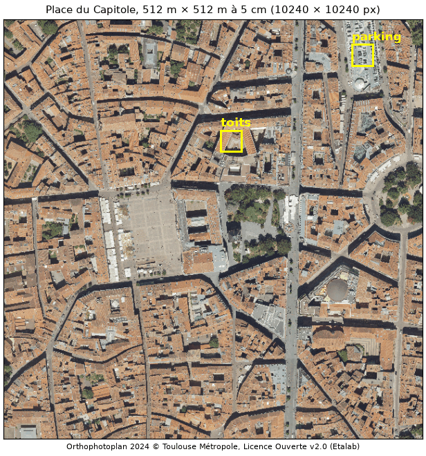
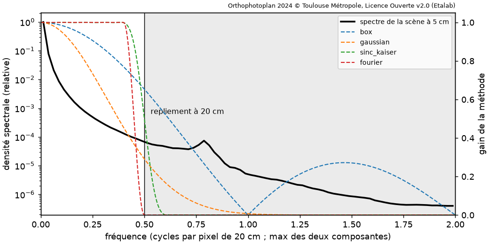
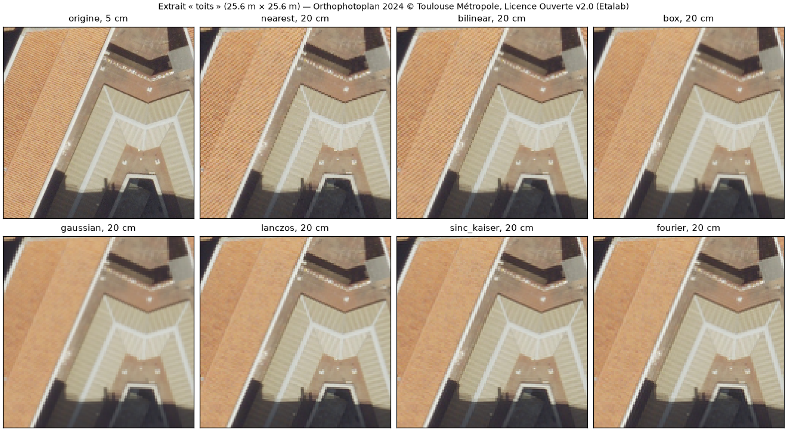
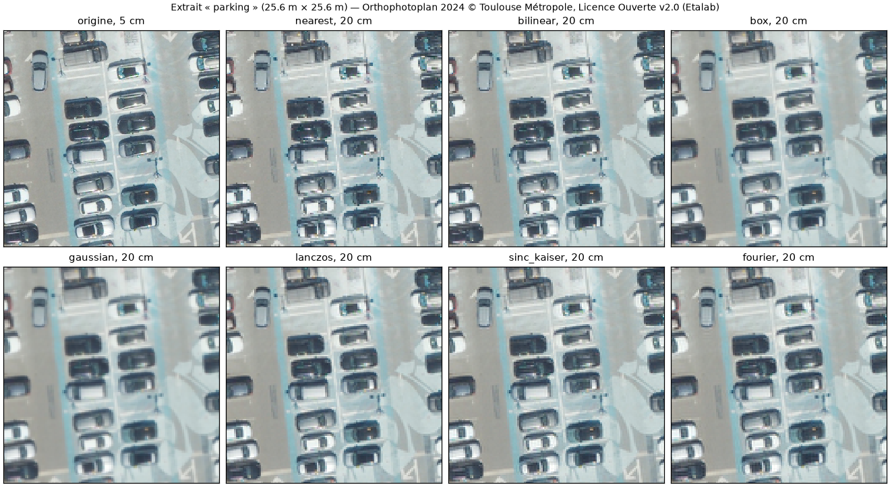

# Diagnostic et cas réel

## 7. Diagnostic

`transfer_function(method, k)` donne la réponse 1D le long d'un axe :
transformée de Fourier à temps discret des poids réellement appliqués
(moyennée sur les positions cibles pour un `k` non entier), ou la
réponse imposée pour les méthodes spectrales. Elle est vérifiée par test
contre le gain mesuré sur des sinusoïdes, y compris repliées.

`kernel_metrics(method, k)` résume le compromis :

| Indicateur | Définition |
|---|---|
| `mtf_nyquist` | gain au Nyquist cible |
| `f90`, `f10`, `transition` | fréquences où le gain passe sous 0,9 et 0,1 ; `transition = f10 - f90` |
| `aliasing` | `∫_{0,5}^{k/2} G² / ∫_0^{0,5} G²` : énergie repliée rapportée à l'énergie conservée, pour un spectre d'entrée blanc (2 = repliement total au facteur 3) |
| `noise_variance_ratio` | variance d'un bruit blanc après / avant réduction (2D) ; `1/k²` pour `box` |
| `overshoot` | dépassement maximal d'un échelon unité, pire phase sous-pixel |

Le bruit en sortie est **corrélé** dès que le noyau couvre plusieurs
pixels cibles : son spectre vaut `σ² |G|²` replié. eoqual-measure
(`noise_power_spectrum`) permet de le vérifier sur une image réduite.

## 8. Cas réel : orthophotographie de 5 cm à 20 cm

Exemple reproductible : `python examples/orthophoto.py capitole_10240.tif`
(tableau ci-dessous et figures de `resources/`).

**Données.** Extrait de 10240 × 10240 pixels (512 m × 512 m, place du
Capitole) de l'*Orthophotoplan 2024* de Toulouse Métropole, image RGB 8
bits au pas de 5 cm, publiée sous [Licence Ouverte v2.0
(Etalab)](https://www.etalab.gouv.fr/wp-content/uploads/2017/04/ETALAB-Licence-Ouverte-v2.0.pdf)
sur [data.toulouse-metropole.fr](https://data.toulouse-metropole.fr/explore/dataset/orthophotoplan-2024/).
Emprise (EPSG:3943, RGF93 / CC43) :
`gdal_translate -projwin 1574165 2268568.5 1574677 2268056.5 <orthophotoplan> capitole_10240.tif`.
L'image n'est pas versionnée dans ce dépôt ; les figures en sont des
extraits, sous la même licence.

**But.** Produire une image à 20 cm (facteur 4, 2560 × 2560 pixels),
comme si la scène avait été acquise par un capteur quatre fois moins
résolu, sans moiré ni décalage.

### 8.1 Ce qui se replie dans cette scène

Le spectre d'une scène urbaine décroît vite, mais garde de l'énergie
au-delà du Nyquist à 20 cm (zone grisée), avec un pic vers 0,78 cycle par
pixel de 20 cm : la périodicité des tuiles canal (environ 25 cm), trop
fine pour être représentée à 20 cm. Une méthode dont le gain n'est pas nul
à cette fréquence la replie en une fausse texture de période plus longue.

### 8.2 Indicateurs

Calculés sur la luminance de l'image entière (2560 × 2560 pixels en
sortie ; Apple M1 Max, un cœur) :

- **contraste des détails fins** : racine du rapport des énergies
  après / avant réduction pour les fréquences de 0,25 à 0,5 cycle par
  pixel de 20 cm (périodes de 40 à 80 cm), à partir du spectre réel de la
  scène et du gain de la méthode ; 1 = détails conservés ;
- **repliement / détails fins** : énergie repliée, rapportée à l'énergie
  de ces mêmes détails fins après réduction ; 0 = aucun moiré ;
- **décalage** : par rapport à l'agrégation exacte (`box`), par
  corrélation de phase sous-pixel, en pixels de 20 cm (lignes ; colonnes) ;
- **écart à la moyenne par blocs** : écart-type de la différence avec
  `box`, en niveaux numériques (NN) — ce qui distingue la méthode d'une
  simple agrégation de pixels ;
- **pixels hors [0, 255]** : dépassements dus aux oscillations, écrêtés
  lors d'un enregistrement en 8 bits.

| Méthode | temps RGB (s) | contraste des détails fins | repliement / détails fins | décalage (px 20 cm) | écart à la moyenne par blocs (NN) | pixels hors [0, 255] |
|---|---|---|---|---|---|---|
| `nearest` | 1,0 | 1,000 | 88,59 % | -0,080 ; -0,095 | 7,57 | 0,000 % |
| `bilinear` | 1,1 | 0,955 | 61,23 % | 0 | 4,45 | 0,000 % |
| `bicubic` | 1,0 | 0,997 | 77,04 % | 0 | 5,69 | 0,001 % |
| `box` | 1,2 | 0,794 | 16,98 % | 0 | 0,00 | 0,000 % |
| `gaussian` | 1,3 | 0,523 | 3,26 % | 0 | 3,55 | 0,000 % |
| `bicubic_aa` | 1,3 | 0,790 | 4,58 % | 0 | 1,75 | 0,005 % |
| `mitchell` | 1,4 | 0,658 | 3,42 % | 0 | 2,40 | 0,000 % |
| `lanczos` | 1,6 | 0,899 | 2,65 % | 0 | 2,44 | 0,010 % |
| `sinc_gaussian` | 1,9 | 0,947 | 1,48 % | 0 | 2,81 | 0,013 % |
| `sinc_kaiser` | 2,5 | 0,966 | 0,98 % | 0 | 3,02 | 0,013 % |
| `fourier` | 34,2 | 0,921 | 0,00 % | 0 | 3,54 | 0,017 % |
| `mtf_target` | 39,9 | 0,551 | 3,55 % | 0 | 3,26 | 0,000 % |
| `sinc_kaiser, grid="origin"` | 2,5 | 0,966 | 0,98 % | 0,365 ; 0,365 | 9,55 | 0,013 % |

`mtf_target` simule ici un capteur de 20 cm (optique gaussienne valant 0,5
au Nyquist × intégration sur le pixel) : son contraste et son repliement
sont ceux de ce capteur, pas ceux d'un filtre anti-repliement.

### 8.3 Ce que montrent les images

Sur les toits, les méthodes sans préfiltrage (`nearest`, `bilinear`) et la
boîte transforment les stries des tuiles, trop fines pour 20 cm, en un
**moiré** de rayures obliques qui n'existe pas sur le terrain. La
gaussienne, Lanczos, le sinc-Kaiser et le gabarit spectral rendent un toit
uniforme : c'est le résultat correct, puisque cette texture n'est pas
représentable à 20 cm. Les bords nets (faîtage, ombres) restent francs
avec les sinus cardinaux fenêtrés, plus doux avec la gaussienne.

Sur le parking, sans texture périodique, les différences sont plus
discrètes : le plus proche voisin donne une image plus granuleuse (les
détails plus fins que 20 cm s'y replient en bruit), les méthodes filtrées
une image plus lisse. La gaussienne adoucit visiblement les contours des
véhicules et les lignes de marquage, que `sinc_kaiser` et `fourier`
gardent nets.

### 8.4 Lecture

- **`sinc_kaiser` (défaut) est le meilleur compromis** : 97 % du
  contraste des détails fins et moins de 1 % de repliement, en 2,5 s pour
  100 millions de pixels RGB.
- **`fourier`** supprime tout repliement mais perd davantage de détails
  (gabarit nul au Nyquist) pour un calcul 14 fois plus long.
- **`box`** (la moyenne par blocs, ou « average » des outils SIG) garde
  17 % de repliement : visible sur les toits. Elle reste la référence si
  la conservation exacte des moyennes par bloc prime.
- **`gaussian`, `mitchell`** ne replient presque pas mais perdent un
  tiers (`mitchell`) à la moitié (`gaussian`) du contraste des détails
  fins : image plus douce que nécessaire.
- **Sans préfiltrage**, 60 à 90 % de repliement : à proscrire pour une
  réduction d'un facteur 4.
- **Géométrie.** Toutes les méthodes sont alignées sur l'agrégation exacte
  (décalage inférieur à 0,005 pixel), sauf le plus proche voisin
  (demi-pixel source inhérent à un facteur pair) et la grille `"origin"`,
  décalée de 0,365 pixel de 20 cm — les `(k − 1) / 2 = 1,5` pixel de 5 cm
  attendus (0,375 pixel de 20 cm) : 7,5 cm sur le terrain, qui suffisent à
  porter l'écart à la moyenne par blocs de 3 à 9,5 NN.
- **Oscillations.** Moins de 0,02 % des pixels sortent de [0, 255] : sur
  une image réelle, déjà adoucie par l'optique, les dépassements des sinus
  cardinaux sont négligeables.
