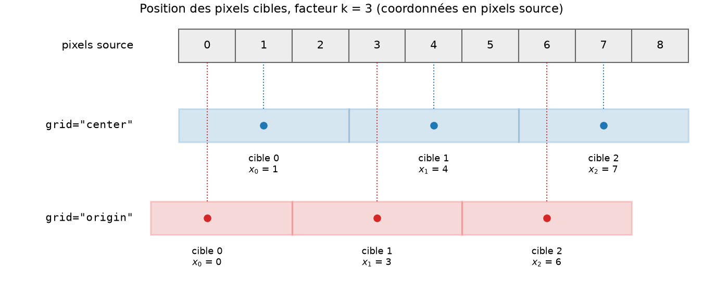

# Le problème et la géométrie de la grille cible

## 1. Le problème

Réduire une image d'un facteur `k` (taille d'un pixel cible en pixels
source), c'est l'échantillonner sur une grille `k` fois plus lâche. Le
Nyquist passe de 0,5 cycle par pixel source à 0,5 cycle par pixel
**cible**, soit `0,5 / k` cycle par pixel source. Tout ce qui dépasse ce
nouveau Nyquist se **replie** : une fréquence `f > 0,5` (en cycles par
pixel cible) réapparaît en `1 - f`, fausse basse fréquence
indiscernable d'un vrai détail (moiré, crénelage).

Une réduction « idéale » doit donc :

1. **filtrer** pour supprimer ce qui dépasserait le nouveau Nyquist, sans
   atténuer ce qui est en deçà ;
2. **échantillonner** aux positions des pixels cibles, sans décalage ;
3. **conserver les niveaux** (une image uniforme reste uniforme, la
   moyenne est conservée).

Le filtre idéal (sinus cardinal infini, réponse en créneau) est
irréalisable et oscillerait fortement près des bords nets (phénomène de
Gibbs). Toute méthode réelle arbitre entre trois défauts : **repliement**
(réponse non nulle au-delà du Nyquist), **flou** (réponse inférieure à 1
en deçà) et **oscillations** (lobes négatifs du noyau).

Notations : `f` est toujours en **cycles par pixel cible** (Nyquist cible
0,5 ; Nyquist source `k / 2`), sauf mention contraire. Les paramètres
des méthodes sont en unités cibles, si bien qu'un réglage garde le même
sens quel que soit `k`.

## 2. Géométrie de la grille cible

Le centre du pixel source `j` est en `j` (pixel = `[j - 1/2, j + 1/2]`).
Le centre du pixel cible `i` est en `x_i` (coordonnées source) :

| `grid` | Position `x_i` | Pixel cible `i` couvre | Usage |
|---|---|---|---|
| `"center"` (défaut) | `(i + 1/2) k - 1/2` | le bloc `[i k - 1/2, (i+1) k - 1/2]` | binning, même emprise que la source |
| `"origin"` | `i k` | `[i k - k/2, i k + k/2]` | sous-échantillonnage « un pixel sur k » |

Avec `"origin"`, le premier pixel cible déborde d'un pixel source à
gauche de l'image et le dernier ne couvre pas la fin de la ligne ; avec
`"center"`, les pixels cibles pavent exactement l'image.
Figure régénérée par `python examples/figures.py`.

Taille de sortie : `floor(n / k)` dans les deux cas (avec `"center"`,
ce sont exactement les pixels cibles entièrement couverts). Avec `shape=`, `k = n / shape` exactement :
l'emprise est conservée.

La convention `"center"` est celle d'un détecteur réel dont les pixels
seraient `k` fois plus grands : pour `k` entier, le pixel cible 0 est la
moyenne des pixels source `0 .. k-1` (`box`). Les deux conventions
diffèrent de `(k - 1) / 2` pixel source : la confondre est la source la
plus courante de biais de recalage entre une image réduite et une image
de référence.
